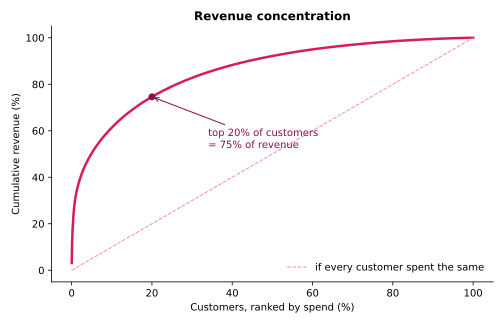
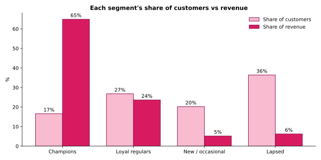

# Customer Segmentation for an Online Retailer (RFM + K-Means)

Grouping 4,338 customers of a UK online gift retailer into four segments based on how recently, how often and how much they buy, and what marketing should do differently for each one.

**Python · pandas · matplotlib · scikit-learn · RFM analysis · k-means clustering · silhouette score · marketing analytics**

## Questions

1. How concentrated is revenue among customers?
2. Can customers be grouped into a small number of segments based on recency, frequency and spend?
3. What should marketing do differently for each segment?

## Data

[Online Retail dataset](https://archive.ics.uci.edu/dataset/352/online+retail) (Chen, 2015), from the UCI Machine Learning Repository, licensed CC BY 4.0. A compressed copy is included in `data/`.

- 541,909 invoice lines from a UK-based online gift retailer, 1 December 2010 to 9 December 2011
- After cleaning: 397,884 lines, 18,532 orders, 4,338 customers and £8.9 million in revenue
- 90% of customers are in the UK, and many are wholesalers

## Method

1. **Cleaning.** Removed lines with no customer ID (24.9%), cancelled invoices (1.7%) and lines with a zero or negative price or quantity.
2. **RFM table.** For each customer: recency (days since last order), frequency (number of orders) and monetary value (total spend).
3. **Feature preparation.** Log-transformed all three variables to reduce heavy right skew (monetary skewness 19.3 before, 0.4 after), then standardised them.
4. **Choosing k.** Compared k = 2 to 8 with inertia and silhouette scores.
5. **Clustering.** K-means with k = 4, checked for stability across 10 other random starts.
6. **Profiling.** Described each segment, then checked it against variables the model never saw (average order value, product range, tenure, country).

## Key findings

**1. Revenue is highly concentrated.** The top 20% of customers generate about **75%** of revenue, and the top 1% generate almost a third. A third of customers (34%) ordered exactly once.



**2. Four segments describe the customer base.**

| Segment | Customers | Typical customer (medians) | Share of revenue |
|---|---|---|---|
| Champions | 720 (17%) | ordered 9 days ago, 10 orders, £3,726 spent | **65%** |
| Loyal regulars | 1,162 (27%) | ordered 54 days ago, 4 orders, £1,354 spent | 24% |
| New / occasional | 877 (20%) | ordered 19 days ago, 2 orders, £451 spent | 5% |
| Lapsed | 1,579 (36%) | ordered 183 days ago, 1 order, £300 spent | 6% |



**3. Champions are one in six customers and almost two thirds of revenue.** Lapsed customers are the largest group by headcount but bring in only 6%.


**4. The segments hold up on variables the model never saw.** Champions and Loyal regulars spend about £360 to £370 per order, against about £230 for the other two segments. A typical Champion has bought 116 different products, a Lapsed customer 17. The UK share is close to 90% in every segment, so the segments are not a proxy for geography.

**5. Sales peak before Christmas.** September to November are the three biggest months, with November (£1.16m) about 2.6 times February (£447k).

## What marketing could do with this

- **Champions:** protect the relationship with early access to the autumn range and account management. No blanket discounts, since they already buy often.
- **Loyal regulars:** the best growth opportunity. They spend as much per order as Champions but order less often, so reminders timed to their usual reorder gap could move some of them up.
- **New / occasional:** aim for a second and third order with a welcome sequence in the first 60 days.
- **Lapsed:** a low-cost win-back email before the September to November peak, then stop spending on those who do not respond.

## Limitations

- A quarter of invoice lines have no customer ID and are excluded, so guest shoppers are not represented.
- The data covers one year, so customers who buy once a year can look lapsed or new when they are regular.
- Many customers are wholesalers, so results would not transfer directly to a consumer-only retailer.
- The clusters overlap (silhouette score 0.34 at k = 4). Two clusters scored higher (0.43) but only separated high from low spenders. The assignment is stable across random starts (adjusted Rand index 0.94 on average).
- This describes past behaviour. Whether the suggested campaigns work would need an A/B test.

## Repository structure

```
├── customer_segmentation.ipynb      # full analysis with code, outputs and written interpretation
├── data/
│   └── online_retail.csv.gz         # UCI Online Retail dataset (compressed)
└── images/                          # charts used in this README
```

## How to run

```bash
pip install pandas numpy matplotlib scikit-learn jupyter
jupyter notebook customer_segmentation.ipynb
```

Run all cells from the repository folder.

---

**Author:** María Sofía Montoya-Chang · M.S. in Data Analytics · [LinkedIn](https://www.linkedin.com/in/maria-montoya-chang)

Data: Chen, D. (2015). Online Retail [Dataset]. UCI Machine Learning Repository. https://doi.org/10.24432/C5BW33
